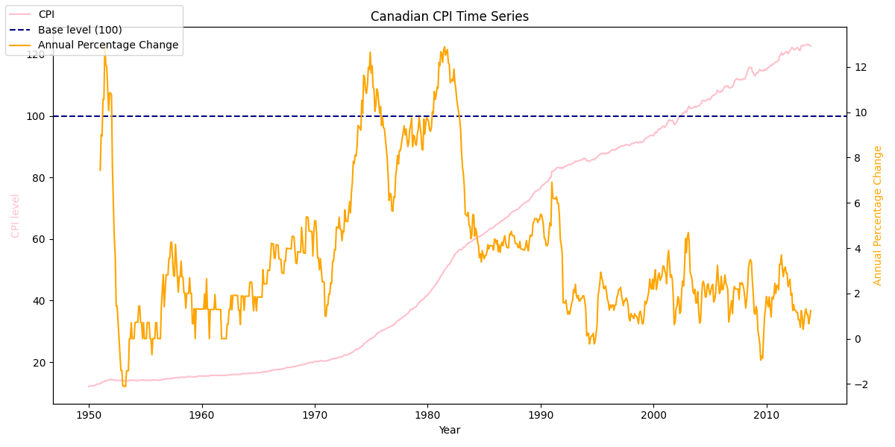

# Assignment 2: Consumer Price Index Calculator 
**Course:** FINE 3300 - Python for Finance
**Student:** Kudrat Mann - 221554530
**Date:** November 16 2026

## Description
This project replicates the Bank of Canada's Inflation Calculator in Python. It reads monthly CPI data, plots a time-series graph, and calculates the equivalent price of goods between any two months from 1950 to 2015.

# How to Run 
To use this program, run the following command in your terminal:

python3 CPI_Calculator.py

First, the graph will appear; after you read it, close it to start the calculator. You will be prompted to enter a dollar amount, a starting month and year, and an ending month and year.

## Files 
- 'CPI_Calculator.py' - Main Python script
- 'CPI_Python_data.csv' - Monthly CPI data from the Bank of Canada
- 'Canadian_CPI_Time_Series.png' - CPI time series graph

## Graph 

The graph shows the Canadian CPI from 1950 to 2015. The pink line shows the CPI level rising over time, crossing the base level of 100 in 1982. The orange line shows the annual percentage change (the sharp inflation spikes of the 1970s and early 1980s reaching over 12%, and a decline to 1-3% range after 1990)

## Sample Output

Enter dollar amount you want to calculate inflation for: 100
Enter starting month (1-12): 3
Enter starting year (1950-2015): 1987
Enter ending month (1-12): 7
Enter ending year (1950-2015): 1999
Results
  $100.00 CAD in 03/1987
  would cost $137.93 CAD in 07/1999.

  Percent change       : 37.93%
  Number of years      : 12.33
  Annual rate of change: 2.64%

  CPI 03/1987          : 67.5
  CPI 07/1999          : 93.1
  (Base year: 2002 = 100.0)

## Source
  Bank of Canada CPI data: https://www.bankofcanada.ca/rates/related/inflation-calculator/
